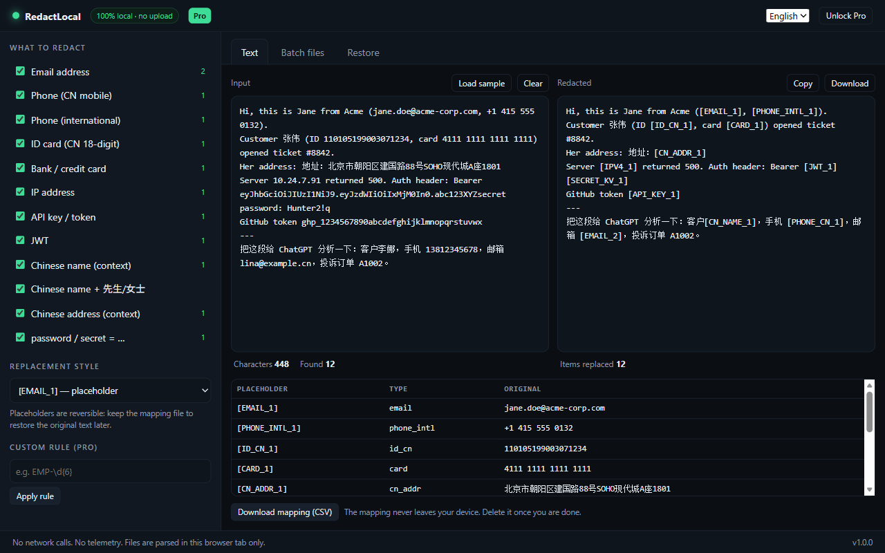

# RedactLocal

**Redact PII in your browser before it reaches an LLM. One HTML file, no upload, no dependencies.**

[中文说明](README.zh-CN.md) · [Live demo](https://zhonghuaquan21-afk.github.io/redactlocal/) · [Report a bug](../../issues)



Teams want to run customer tickets, CRM exports and API logs through an LLM. Legal says the customer
data can't leave the building. RedactLocal is the middle path: it strips identifiers **in the browser
tab**, gives you back text that is safe to paste anywhere, and keeps a local mapping so you can put
the real values back into the model's answer afterwards.

There is no server component. Open DevTools → Network and watch: zero requests while redacting.

---

## Why another redaction tool

Most "anonymize before AI" tools are SaaS, which defeats the purpose — you upload the sensitive file
to a third party to have it redacted. Most enterprise DLP is a six-month procurement.

This one is a single HTML file you can audit in a text editor:

- **13 detector families** covering both Western and Chinese PII
- **Key-aware**: reads JSON keys, so `"address": "…"` is caught without any 地址 prefix
- **Batch CSV** with structure, quoting and encoding preserved
- **Reversible**: placeholders like `[EMAIL_1]` map back to the originals
- **Zero dependencies, zero network calls, works offline** (including air-gapped machines)
- **Bilingual UI** (English / 中文)

---

## Quick start

```bash
git clone https://github.com/zhonghuaquan21-afk/redactlocal.git
cd redactlocal
```

Then **double-click `index.html`**. That's it — no install, no build, no npm.

To run it locally over HTTP instead (some browsers behave better with `file://` restrictions):

```bash
npm run serve      # http://127.0.0.1:8123
```

For the Chinese build: open `cn/index.html` (generated from `index.html`, see [Building](#building)).

---

## What gets detected

| Group | Detectors |
|---|---|
| Contact | Email, CN mobile (incl. `138 1234 5678` / `138-1234-5678`), international phone |
| Identity | CN resident ID (18-digit), Chinese name (context), name + 先生/女士, user/customer ID |
| Address | Chinese address (context), postal code (via JSON key) |
| Financial | Bank / credit card (Luhn as a confidence signal, never a filter) |
| Secrets | API keys, JWTs, `password:` / `密钥：` style key-value pairs |
| Network | IPv4 addresses |

### Replacement modes

| Mode | Output | Use when |
|---|---|---|
| Placeholder | `[EMAIL_1]` | You plan to restore the original later (default) |
| Partial mask | `j***@***.com` | Displaying redacted data to a human |
| Hash | `EMAIL_b82964e8` | You want stable pseudonyms without a mapping file |
| Remove | *(deleted)* | The item is pure noise for the task |

### JSON / structured payloads

Semantics live in the **key**, not the value. `"address": "江西省…"` contains no `地址` prefix, so
value-shape rules alone will miss it. RedactLocal also matches `"key": "value"` pairs and classifies
by key name:

| Key contains | Treated as |
|---|---|
| `id_card`, `identity`, `身份证` | ID number |
| `bank_card`, `card_no`, `account_no` | Bank card |
| `phone`, `mobile`, `tel` | Phone |
| `email`, `mail` | Email |
| `password`, `pwd`, `secret`, `token`, `密钥` | Secret value |
| `address`, `addr`, `地址` | Address |
| `postcode`, `zip`, `邮编` | Postal code |
| `name`, `user_name`, `receiver`, `contact` | Person name |
| `userId`, `user_id`, `uid`, `customerId` | Identifier |

`goods_name`, `product_name`, `file_name`, `company_name` are explicitly excluded — otherwise your
product names get redacted and the model has nothing left to reason about.

---

## Verifying the privacy claim

Marketing claims are cheap. Two minutes:

1. Open the app, press F12, go to **Network**, clear it.
2. Paste text containing an email address.
3. Watch the panel. No request means no upload.
4. Better: disconnect from the network and try again. A genuinely local tool behaves identically.

Since it is a single file, `Ctrl+U` shows the whole program. Search for `fetch(`, `XMLHttpRequest`
and `sendBeacon` — there is nothing to find.

---

## Tests

```bash
npm test              # both builds: 54 assertions
npm run test:en       # English build only
npm run test:cn       # Chinese build only
```

The suite extracts the `<script>` block out of `index.html` and runs it against a minimal DOM stub,
so **the tests exercise the exact file that ships** — no duplicated logic drifting apart over time.

Coverage: the five reference payloads (plain text, JSON, special characters, an HTTP request, a
12k-character log), all 13 detector families, over-redaction guards (order numbers, amounts,
timestamps, product names), consistency and idempotence, mapping round-trips including the
`[EMAIL_1]` vs `[EMAIL_10]` prefix trap, the three replacement modes, CSV quoting, and a 200k-character
performance check (~20 ms in Chromium).

`npm test` also prints a **known limitations** section for things the regex engine genuinely cannot
catch — it is deliberately excluded from the pass rate rather than hidden.

---

## Building

`index.html` is the source of truth. The Chinese build is generated, not hand-edited:

```bash
npm run build:cn      # regenerates cn/index.html (20 replacements, fails loudly if the source drifts)
```

CI runs the tests against both builds and fails if `cn/index.html` is stale relative to `index.html`.

---

## Known limitations

Read this before trusting it with production data.

- **Free-form names in prose** are not caught. "张伟昨天打电话说…" has no context keyword; regex
  can't resolve it. Use a custom rule or review manually.
- **Bare addresses without a prefix** are missed (`北京市朝阳区…` with no `地址：`).
- **English person names** are not detected.
- **Full-width digits** (`１３８…`) are not normalised.
- **Indirect identifiers** — a rare job title plus a city plus a date — are out of scope entirely.
  Redaction does not give you k-anonymity.
- **Images and attachments** are not handled.
- **Not a compliance control.** It is a data-minimisation measure. Lawful basis, retention,
  processor agreements and DPIAs are separate questions. Nothing here is legal advice.

Checksums follow one rule: **a failed check lowers confidence, it never drops a candidate.** A bank
card that fails Luhn is still redacted and flagged in the UI, because a silent miss is far worse than
an extra asterisk.

---

## Contributing

Detector improvements and false-positive reports are the most useful contributions. See
[CONTRIBUTING.md](CONTRIBUTING.md) — the short version: add a failing test first, then make it pass.

## Security

See [SECURITY.md](SECURITY.md) for the threat model and how to report an issue privately.

## License

[MIT](LICENSE). Use it, fork it, ship it inside your company.
