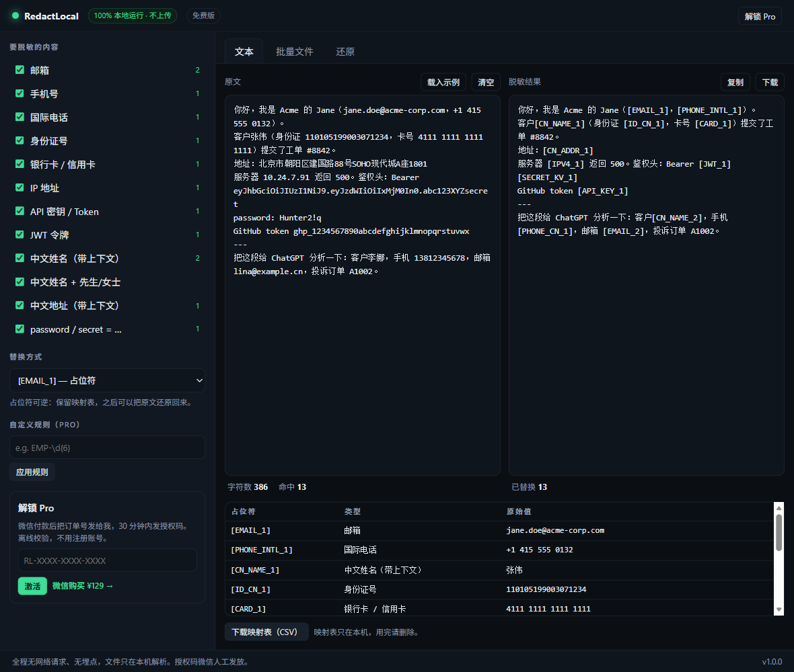

# RedactLocal

**在浏览器里把客户隐私抹掉，再交给大模型。单文件、不上传、零依赖。**

[English](README.md) · [在线试用](https://zhonghuaquan21-afk.github.io/redactlocal/) · [报告问题](../../issues)



公司想用大模型分析客服工单、CRM 导出和接口日志，但法务不让客户数据出门。
RedactLocal 是中间那条路：**在当前标签页里**把敏感信息替换成占位符，给你一段可以放心发出去的文本，
同时在本地保留映射表，AI 给出的回答还能把真名真号换回去。

没有后端。打开开发者工具的「网络」面板，边脱敏边看：零请求。

---

## 为什么再造一个脱敏工具

市面上的"AI 前置脱敏"大多数是 SaaS——为了脱敏，你得先把敏感文件上传给第三方，逻辑上说不通。
企业级 DLP 则是半年起步的采购流程。

这个工具是一个可以直接用记事本审阅的 HTML 文件：

- **13 类识别**，中英文 PII 都覆盖
- **按 key 识别**：JSON 里 `"address": "…"` 没有「地址」两个字也能命中
- **批量 CSV**，保留结构、引号与编码
- **可还原**：`[EMAIL_1]` 这类占位符能映射回原文
- **零依赖、零网络请求，断网可用**（含内网/气隙机器）
- **中英双语界面**

---

## 快速开始

```bash
git clone https://github.com/zhonghuaquan21-afk/redactlocal.git
cd redactlocal
```

然后**双击 `index.html`**。不需要安装、不需要构建、不需要 npm。

想用本地 HTTP 打开（部分浏览器对 `file://` 有限制）：

```bash
npm run serve      # http://127.0.0.1:8123
```

国内版是 `cn/index.html`，由 `index.html` 生成，见[构建](#构建)。

---

## 能识别什么

| 分组 | 识别项 |
|---|---|
| 联系方式 | 邮箱、手机号（含 `138 1234 5678` / `138-1234-5678`）、国际电话 |
| 身份 | 18 位身份证、中文姓名（带上下文）、姓名+先生/女士、用户/客户编号 |
| 地址 | 中文地址（带上下文）、邮编（JSON key） |
| 资金 | 银行卡 / 信用卡（Luhn 只作置信度，绝不作过滤器） |
| 密钥 | API Key、JWT、`password:` / `密钥：` 这类键值对 |
| 网络 | IPv4 地址 |

### 四种替换方式

| 模式 | 输出 | 适用 |
|---|---|---|
| 占位符 | `[EMAIL_1]` | 之后要还原（默认） |
| 部分打码 | `j***@***.com` | 给人看 |
| 哈希 | `EMAIL_b82964e8` | 要稳定假名又不想留映射表 |
| 直接删除 | *（删掉）* | 对任务毫无价值的信息 |

### JSON 结构化数据

语义在 **key** 里，不在 value 里。`"address": "江西省…"` 里没有「地址」前缀，只靠值的形态抓不到。
所以还会匹配 `"key": "value"` 并按键名归类，详见 [README.md](README.md#json--structured-payloads)。

`goods_name`、`product_name`、`file_name`、`company_name` 被显式排除——否则商品名被抹掉，模型就没东西可分析了。

---

## 怎么验证"真的不上传"

1. 打开应用，按 F12 → 网络 → 清空
2. 粘一段带邮箱的文本
3. 看有没有请求。没有就是真的没有
4. 更彻底：断网再试，行为完全一样

整页就是一个文件，`Ctrl+U` 能看到全部源码，搜 `fetch(`、`XMLHttpRequest`、`sendBeacon` 什么也没有。

---

## 测试

```bash
npm test              # 两个版本，54 项断言
npm run test:en       # 只测英文版
npm run test:cn       # 只测国内版
```

测试会从 `index.html` 里抽出 `<script>` 代码在最小 DOM 桩里跑，**测的就是将要发布的那份文件**，
不存在测试代码和产品代码各一份、慢慢对不上的问题。

覆盖：5 组参考载荷、13 类识别、过度脱敏守卫（订单号/金额/时间戳/商品名）、一致性与幂等、
映射表往返（含 `[EMAIL_1]` vs `[EMAIL_10]` 前缀冲突）、四种替换模式、CSV 引号、20 万字性能（Chromium 约 20ms）。

`npm test` 末尾会单列**已知边界**——真正抓不到的东西，不计入通过率，也不藏着。

---

## 构建

`index.html` 是唯一真相源，国内版是生成物：

```bash
npm run build:cn      # 重新生成 cn/index.html（20 处替换，源文件漂移会直接报错）
```

CI 会同时测两个版本，并在 `cn/index.html` 过期时失败。

---

## 已知边界

在使用真实数据前请读完。

- **散文里的自由姓名抓不到**（"张伟昨天打电话说…"），没有上下文的锚点，正则无能为力
- **无前缀的裸地址**会漏（没有「地址：」的 `北京市朝阳区…`）
- **英文人名**不识别
- **全角数字**（`１３８…`）不做归一化
- **间接标识符**（罕见职位 + 城市 + 日期）完全超出范围，脱敏不等于 k-匿名
- **图片和附件**不处理
- **不是合规控制**。它是一项数据最小化措施；合法性基础、留存期限、委托处理协议是另外的问题。
  本文不构成法律意见

校验位只遵守一条规则：**校验失败只降低置信度，绝不丢弃候选**。Luhn 不通过的卡号照样遮蔽并在界面提示——
静默漏掉比多打几个星号糟糕得多。

---

## 参与贡献

最有价值的贡献是补识别规则和报告误判。见 [CONTRIBUTING.md](CONTRIBUTING.md)——
一句话版本：**先加一个会失败的测试，再让它通过**。

## 安全

见 [SECURITY.md](SECURITY.md)，包含威胁模型与私下报告方式。

## 许可证

[MIT](LICENSE)。随便用、随便 fork、随便在公司内部部署。
